# Setup guide with screenshots

Red numbers in the screenshots are the click order, 1 to 34 across the whole guide.
Identifiers in the screenshots are blurred.

## 0. What you need

You enter 3 values in the Azure deployment form. Everything else keeps its default.
Order: get your SOCRadar API key and Company ID (1), deploy (2), check the deployment (3), check the Logic Apps (4), check Microsoft Sentinel (5), find the incidents in Microsoft Defender (6).

| Value | Goes to | Where you find it | Section |
|-------|---------|-------------------|---------|
| `WorkspaceName` | Azure deployment form | Your Microsoft Sentinel workspace, or a new name | 2.1 |
| `SocradarApiKey` | Azure deployment form | SOCRadar platform > API Management, a **Company** key | 1.0, 1.1 |
| `CompanyId` | Azure deployment form | SOCRadar platform, the number after `/company/` in the API reference examples | 1.2 |

You need Owner or User Access Administrator on the resource group: the deployment creates role assignments.
The deployment takes 1-2 minutes. The first alarms appear about 3 to 6 minutes later, and the first incidents in Microsoft Sentinel about 20 to 30 minutes after that.

## 1.0 SOCRadar platform: API Management

1. Open **API & Integrations** in the left menu, then **API Management**.
2. Under **API Keys**, click **Manage and View All**.

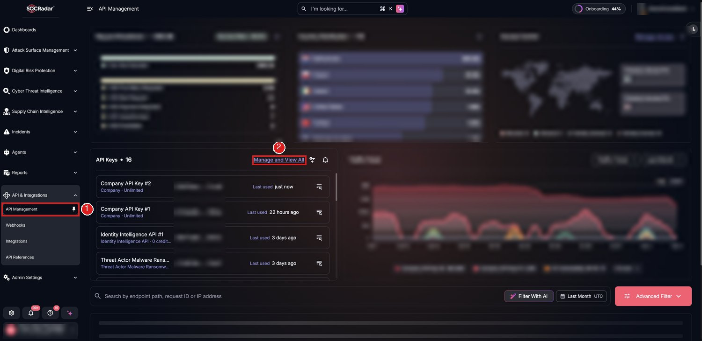

## 1.1 Copy a Company API key

3. Use a key of type **Company** (listed under the key name). Hover over the key value and click the copy icon. Goes to the Azure form *Socradar Api Key* (11).
   The key is only needed in the deployment form. It is not written to the Logic App run history.

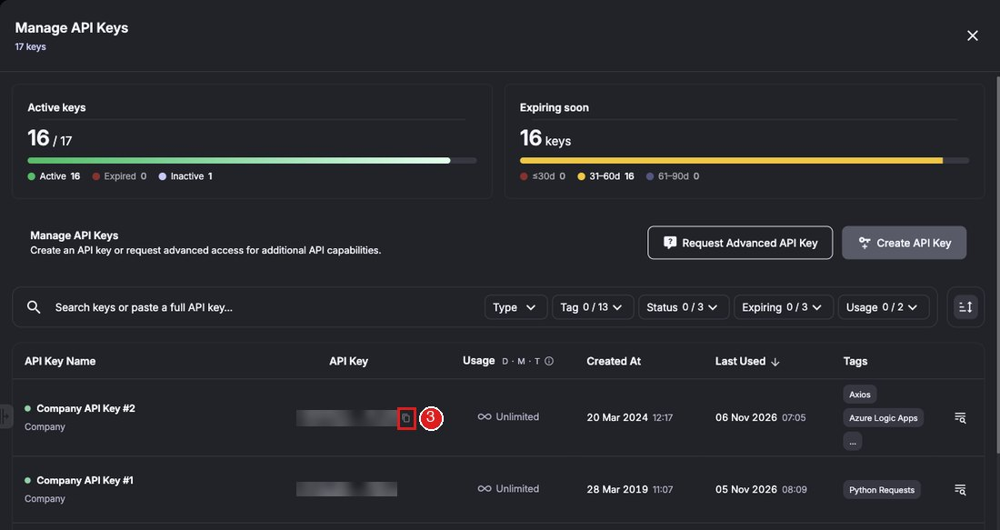

## 1.2 Find the Company ID

4. Click **API References** in the same menu.
5. Open any request, for example **Incident API V4 > Retrieve incident details**. In the example URL `.../api/company/<number>/incidents/v4` the number is your Company ID. Goes to the Azure form *Company Id* (12).

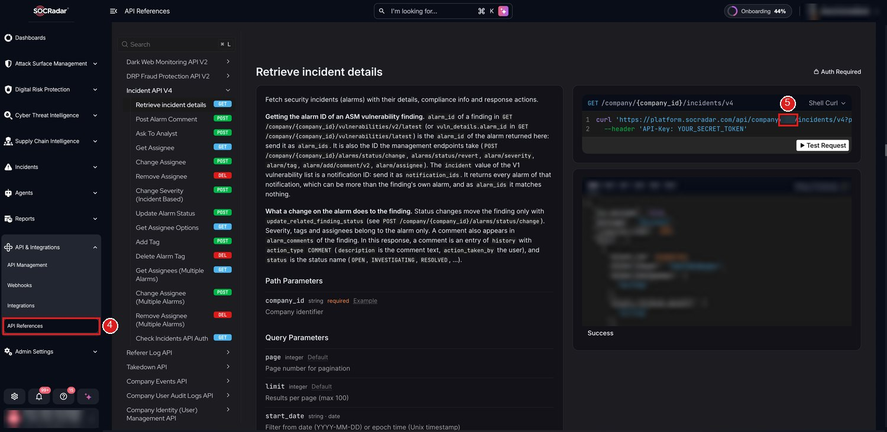

## 2.0 Deploy to Azure

6. **Deploy to Azure** in the [README](../README.md). The Custom deployment form opens.

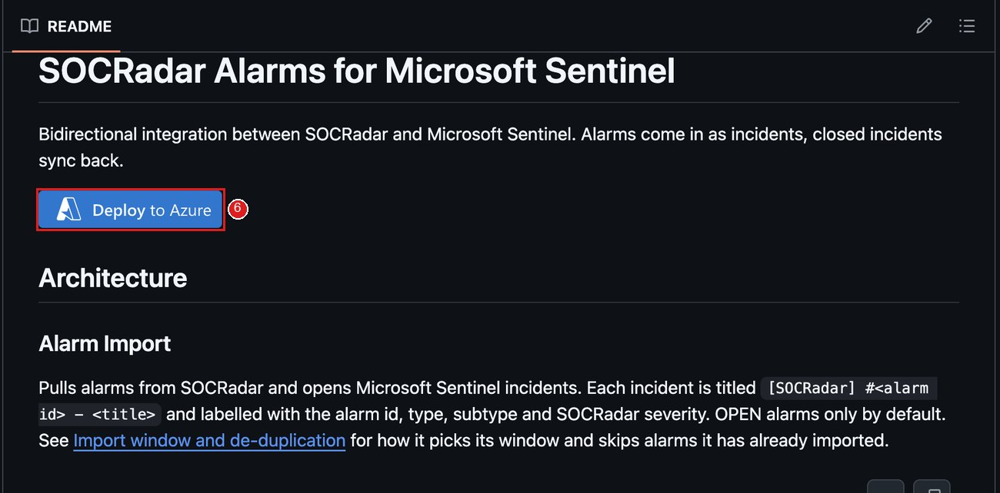

## 2.1 Custom deployment form

Check the subscription. Leave every field you are not told to change.

7. **Resource group**: the one that already holds your Microsoft Sentinel workspace. **Create new** works with `Deploy New Workspace = true` in step 10.
8. **Region**: the region of that resource group.
9. **Workspace Name**: the name of your Microsoft Sentinel workspace, not its ID.
10. **Deploy New Workspace**: the default `false` uses the existing workspace in the resource group you chose. A name that does not exist fails before anything is created. Set it to `true` to create the workspace and enable Microsoft Sentinel.
11. **Socradar Api Key**: the key from 3.
12. **Company Id**: the number from 5.
13. Optional: **Initial Lookback Minutes** (default `600`, 10 hours) is how far back the first run looks for open alarms. 10 to 10080 (7 days). It only applies to the first run.
    **Incident Mode** stays `AlertBacked`: that is what makes the incidents show up in Microsoft Defender.
14. **Review + create**, then **Create**. Takes 1-2 minutes.

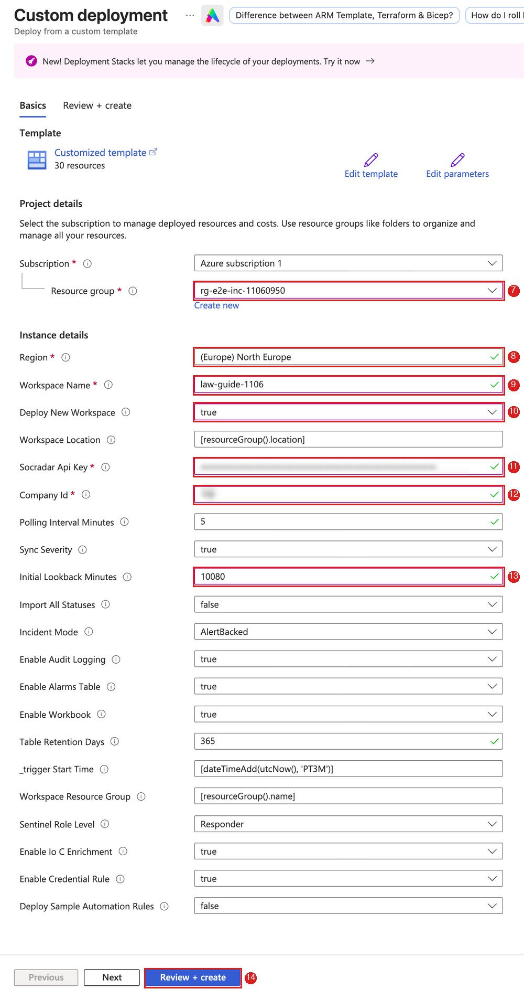

## 2.2 Deployment complete

15. **Go to resource group**.

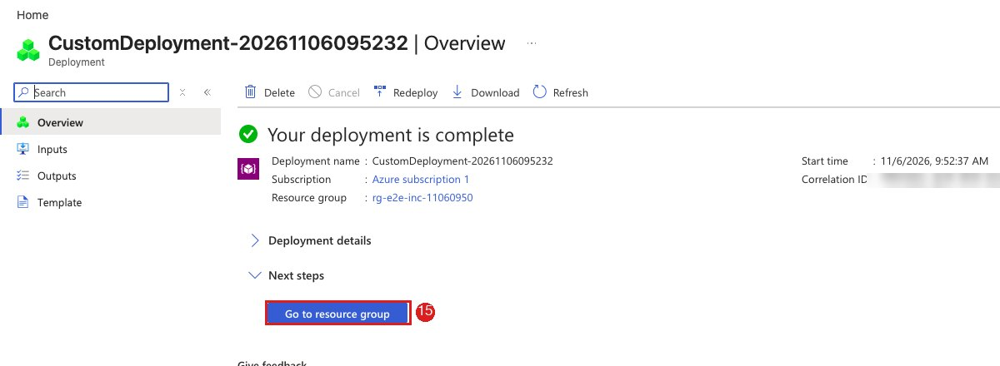

## 3.0 Resource group > Deployments

16. Left menu **Settings** > **Deployments**.
17. Both deployments show **Succeeded**. The second one, `deploy-alert-backed-rule`, installs the analytics rules for alert-backed mode.

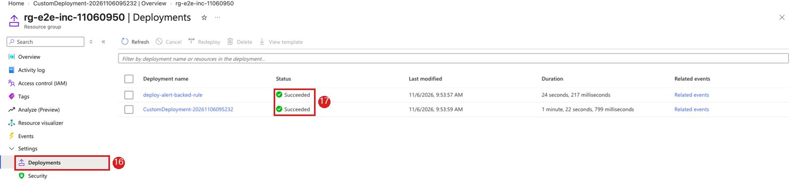

## 3.1 Resource group > Overview

The screenshot is from a deployment with `Deploy New Workspace = true`: 10 resources, the Log Analytics workspace with Microsoft Sentinel, the checkpoint storage account, a data collection endpoint with two data collection rules, the Microsoft Sentinel API connection, the **SOCRadar Integration Dashboard** workbook and the two Logic Apps. With an existing workspace the list looks the same, plus whatever the resource group already held.

18. Click **Overview** to see the resources.
19. **SOCRadar-Alarm-Import**: opened in 4.0.
20. **SOCRadar-Alarm-Sync**: opened in 4.1.

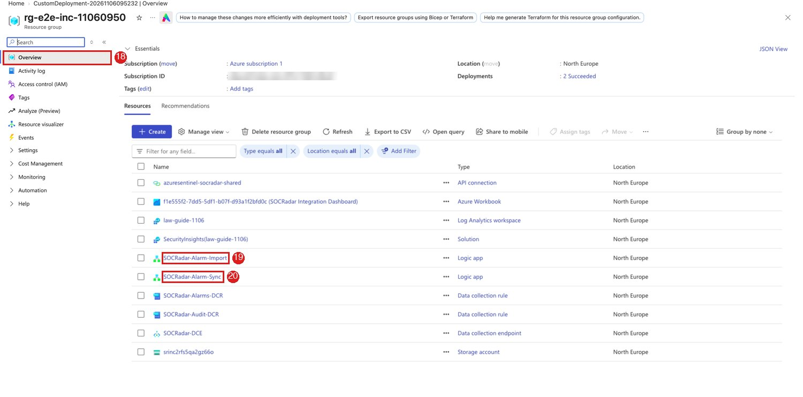

## 4.0 SOCRadar-Alarm-Import: run history

Logic Apps start 3 minutes after the deployment. Open **SOCRadar-Alarm-Import** (19) and **Run history**.

21. The first run is **Succeeded**. Measured here: it started 3 minutes after the deployment and took 51 seconds for 8 alarms.

If it shows **Failed**, open the run and then **Pagination_Loop**:

- `Unauthorized` on **Get_SOCRadar_Page** means HTTP 401: the key does not belong to this Company ID. HTTP 402 means no credit, an inactive key or an invalid key. Fix it as described in [Rotating the API key](../README.md#rotating-the-api-key).
- A wrong `Workspace Name` with `Deploy New Workspace = false` never gets here: the deployment fails first and nothing is created.

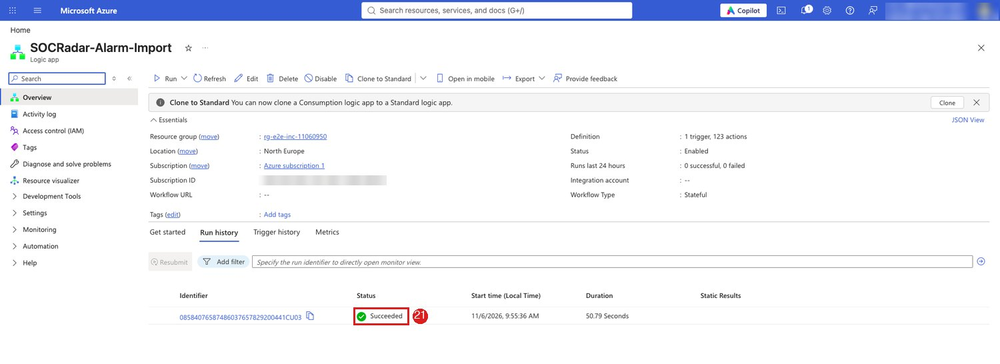

## 4.1 SOCRadar-Alarm-Sync: run history

Go back to the resource group and open **SOCRadar-Alarm-Sync** (20).

22. **Succeeded**. Sync only has work when you close an incident, so a run with nothing to sync is quick. It does not prove the key works: judge the key by the Import run.

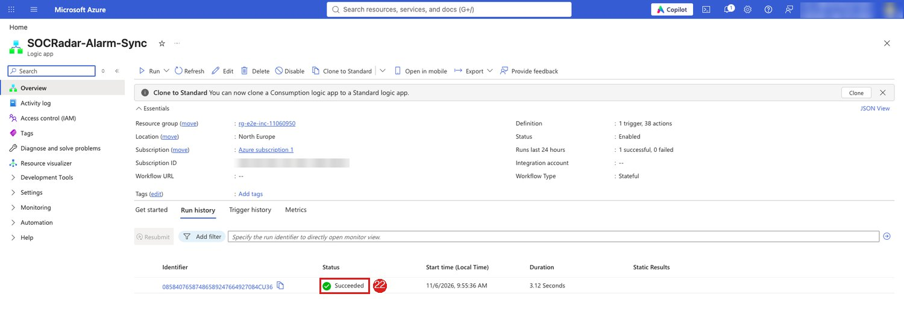

## 5.0 Microsoft Sentinel: Analytics

Open **Microsoft Sentinel**, pick the workspace.

23. **Configuration** > **Analytics**.
24. Five rules named `SOCRadar - ...` are **Enabled**: Lookalike and phishing domain, Vulnerability and CVE, Data leak and PII exposure, Other alarms, Credential exposure. Each one raises an alert, and an incident, for every matching alarm.

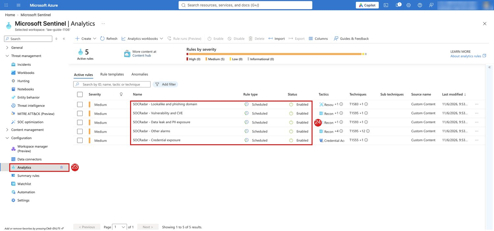

## 5.1 Logs: the alarms table

Open the workspace **Logs**. Switch to **KQL mode** if the editor shows *Simple mode*.

25. Enter the query:
    ```
    SOCRadar_Alarms_CL | project TimeGenerated, AlarmId, AlarmMainType, AlarmSubType, Severity, Status
    ```
26. **Run**.
27. One row per imported alarm. The first rows can take a few minutes after the Import run: a new table is slow to show its first data.

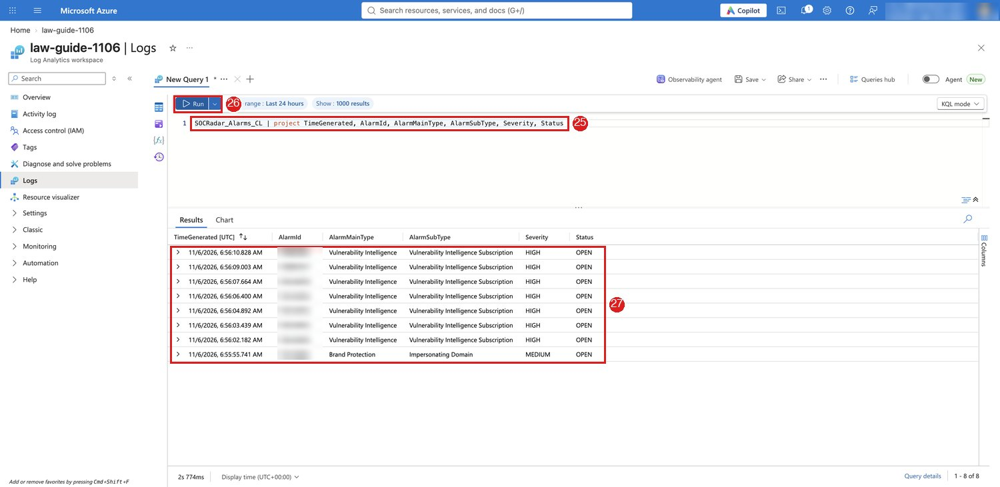

## 5.2 Incidents

The rule runs every 10 minutes and waits 12 minutes before it reads a new alarm row, so the first incident comes about 20 to 30 minutes after the row reached the table (measured here: 29 minutes).

28. **Threat management** > **Incidents**.
29. One incident per alarm, titled `[SOCRadar] #<alarm id> - <title>`. The incident provider shows Microsoft Defender, because in `AlertBacked` mode the alert is what creates the incident.

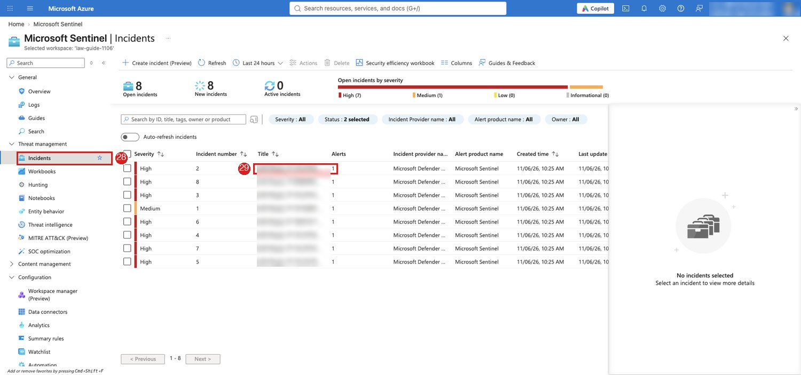

## 5.3 Workbooks

30. **Threat management** > **Workbooks**.
31. Click **SOCRadar Integration Dashboard**.
32. **View saved workbook**.

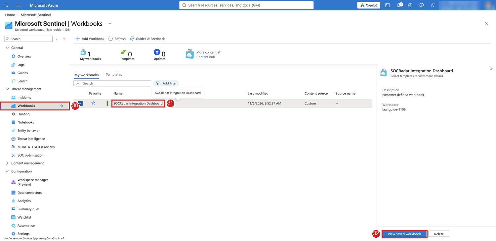

The dashboard counts alarms by severity, status and type from the alarms table:

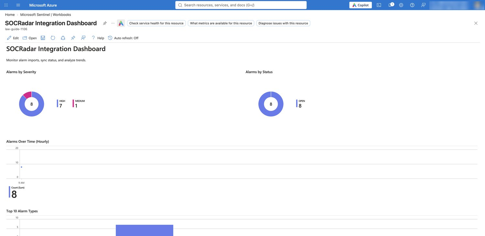

## 6.0 Microsoft Defender portal

Incidents created in this mode are also listed in the Microsoft Defender portal. Open [security.microsoft.com](https://security.microsoft.com) and go to **Cases**. The workspace has to be connected to the Defender portal; if it is not listed, connect it in **System > Settings > Microsoft Sentinel > Workspaces**.

33. **Search**: enter the alarm id from the incident title, or `SOCRadar`. A new case is at the top only when the list is sorted by Case ID, newest first, as in the screenshot; the list can also open sorted by priority.
34. The case has the same title as the Microsoft Sentinel incident.

If the list opens with a **Priority score** filter of 15 to 100, the SOCRadar cases are hidden: SOCRadar incidents score Low (measured 1 to 5; one case showed *Not set*). Click **Reset all** or include **Low priority**, then search again. To keep the view, save the filter with **Filter set > Save**.

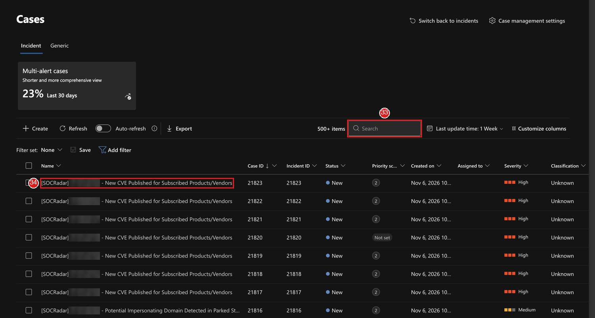
